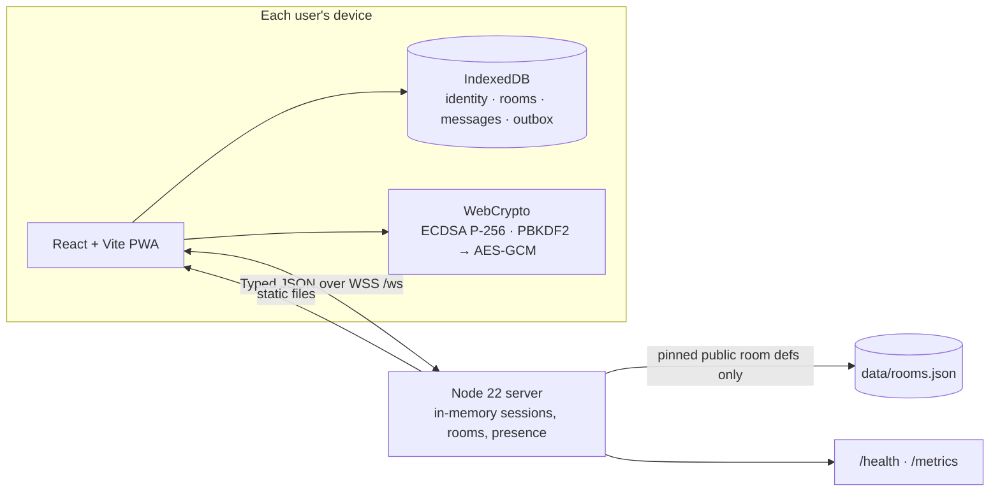

# Pulse

Pulse is an account-free realtime communication PWA. There is **no database**: the server holds only live session state in memory, and each person's identity, rooms and message history live on their own device (IndexedDB), exportable as a single JSON file they own.

## Status

| Phase | Scope | State |
| --- | --- | --- |
| 1 | Monorepo, Zod protocol, P-256 identity, signed handshake, presence | ✅ Done |
| 2 | Public rooms (create, directory, trending, slow mode, caps, expiry, pinning + `rooms.json`), text chat, IndexedDB, export/import (+ encrypted), offline queue, local search | ✅ Done |
| 3 | 1:1 voice/video (P2P), TURN, Web Push for calls | ⏳ Next |
| 4 | DMs + private rooms with E2EE, file transfer over DataChannel | ⏳ |
| 5 | Nearby discovery | ⏳ |
| 6 | Group calls (mesh → mediasoup SFU), screen share | ⏳ |
| 7 | Safety layer, moderation, full rate-limit policy | ⏳ (token-bucket limits already in place) |
| 8 | PWA/service worker, i18n (en/bn), a11y audit, load test, STRIDE + privacy docs | ⏳ |

## Architecture



- **One process, one port.** In production the Node server serves the built web app *and* the WebSocket at `/ws`, so the app is a single origin (simple to host, strict CSP `connect-src 'self'`).
- **Ephemeral server.** Sessions, room membership and presence are memory-only. A restart clears them; clients reconnect automatically (exponential backoff + 60 s resume token).
- **The only file written** is `data/rooms.json`: definitions of *pinned public* rooms (name, topic, rules, owner public key). Debounced to once per 10 s, written atomically (temp file → rename). Never messages, never locations.

## Run locally

Requires Node 22 and pnpm.

```powershell
pnpm install
pnpm dev          # web on https://localhost:5174 (self-signed), server on :8787
```

The dev web server listens on all interfaces with a self-signed certificate (WebCrypto needs a secure context), and proxies `/ws` to the server, so other devices on your LAN can open `https://<your-ip>:5174` (accept the certificate warning once).

Production-style run (one process):

```powershell
pnpm build
pnpm start        # http://localhost:8787 serves the app and /ws
```

Checks:

```powershell
pnpm typecheck
pnpm test         # Vitest: protocol, rate limiter, rooms/snapshot, hub, crypto/backup
pnpm e2e          # Playwright: two browsers create/join/chat, offline queue, export/import
pnpm gen:schema   # regenerate docs/export.schema.json from the Zod source
```

## Environment variables (server)

| Variable | Default | Purpose |
| --- | --- | --- |
| `PORT` | `8787` (`8080` in Docker) | HTTP + WebSocket port |
| `HOST` | `0.0.0.0` | Bind address |
| `NODE_ENV` | — | `production` enables HSTS |
| `ALLOWED_ORIGINS` | *(empty)* | Comma-separated browser origins allowed to open `/ws`. Empty = same host as the request |
| `WEB_DIST` | `apps/web/dist` | Built web app to serve |
| `DATA_DIR` | `apps/server/data` | Where `rooms.json` is written. Empty string disables it |
| `ROOM_IDLE_MINUTES` | `30` | Empty, unpinned rooms expire after this |
| `LOG_LEVEL` | `info` | pino level. Logs never contain message text, handles or locations |

## Deploy

### Docker (any VPS)

```bash
docker compose up -d --build                      # app on :8080
ALLOWED_ORIGINS=https://pulse.example.com docker compose up -d
TURN_SECRET=change-me docker compose --profile media up -d   # + coturn (calls, Phase 3+)
```

Put Caddy or nginx in front for HTTPS. Caddy example:

```
pulse.example.com {
  reverse_proxy 127.0.0.1:8080
}
```

### Render (free tier)

`render.yaml` is a blueprint: create a new Blueprint from the repo, then add your domain under *Settings → Custom Domains* and create the DNS record Render shows you (a `CNAME` for a subdomain) in your DNS provider (e.g. Hostinger hPanel → *Domains → DNS / Nameservers*). Free instances sleep when idle (first load takes ~50 s), and free hosts cannot run TURN or the SFU; calls will rely on public STUN.

## Protocol (v1)

Every frame is `{ "v": 1, "type", "requestId", "payload" }`, validated with Zod in `packages/protocol` on both ends. Unknown types, wrong versions and oversized frames (> 64 KB) are rejected.

| Direction | Type | Payload |
| --- | --- | --- |
| S → C | `server.challenge` | `{ challenge, expiresAt }` (sent on connect, valid 60 s) |
| C → S | `client.hello` | `{ publicKey, signature, handle, resumeToken? }` (ECDSA P-256 signature of the challenge) |
| S → C | `server.ready` | `{ sessionId, publicKey, resumeToken, resumed, joinedRooms, rooms }` |
| C → S | `profile.update` | `{ handle }` |
| C → S | `presence.update` | `{ status: online \| away \| dnd \| invisible }` |
| S → C | `presence.snapshot` | `[{ publicKey, handle, status, rooms[] }]` (invisible users omitted) |
| C → S | `room.list` | — |
| S → C | `room.listed` | `{ rooms }` (public rooms, busiest first) |
| C → S | `room.create` | `{ name, topic, emoji, mode, memberCap, slowModeSec, rules }` |
| C → S | `room.join` / `room.leave` | `{ roomId }` |
| S → C | `room.joined` | room |
| S → C | `room.left` / `room.removed` | `{ roomId }` |
| S → C | `room.updated` | room (broadcast on membership/pin changes) |
| C → S | `room.pin` | `{ roomId, pinned }` (owner only) |
| C → S | `chat.send` | `{ roomId, text, clientMessageId }` |
| S → C | `chat.message` | `{ id, clientMessageId, roomId, text, author: { publicKey, handle }, sentAt }` |
| S → C | `server.error` | `{ code, message, retryAfterMs? }` |

Error codes: `INVALID_MESSAGE`, `AUTH_FAILED`, `NOT_AUTHENTICATED`, `RATE_LIMITED`, `ROOM_NOT_FOUND`, `ROOM_FULL`, `NOT_IN_ROOM`, `TOO_MANY_ROOMS`, `SLOW_MODE`, `FORBIDDEN`, `INTERNAL`.

Rate limits are token buckets enforced **both per connection and per public key** (frames, chat, room creation, joins, profile changes), so opening more sockets does not multiply throughput.

## Export file

`Settings → Your data` exports `pulse-<handle>-<date>.json` (schema: [`docs/export.schema.json`](docs/export.schema.json)) or an encrypted backup (PBKDF2-SHA256, 600k iterations → AES-GCM-256; schema: [`docs/export-encrypted.schema.json`](docs/export-encrypted.schema.json)).

**Migrations:** every file carries `format` and an integer `version`. On import, `migrateExport()` applies step-wise migrations (`v1→v2→…→current`) and then validates against the current schema. Files from a *newer* version are rejected with a clear message instead of being guessed at. To change the format: bump `EXPORT_VERSION`, add `migrations[old] = (data) => upgraded`, add a test.

## Security & privacy notes (current)

- The private key never leaves the device except inside the user's own export. The UI warns that plain exports contain it and offers the encrypted backup.
- Server checks a fresh signed challenge on every connection; resume tokens only work for the same public key within 60 s.
- Strict CSP, `X-Frame-Options: DENY`, `nosniff`, `Referrer-Policy: no-referrer`, HSTS in production, Origin check on the WebSocket upgrade, path-traversal-safe static serving.
- Public rooms are plaintext by design (so they can be moderated). Private rooms and DMs will be end-to-end encrypted (Phase 4).
